# PulseSentiment — Twitter Sentiment Analysis Platform Using NLP

PulseSentiment is a production-grade, end-to-end sentiment intelligence platform designed to extract, analyze, and quantify emotional polarity in Twitter/X posts. Combining scikit-learn machine learning, conservative Natural Language Processing (NLP), a high-performance FastAPI backend, SQLite audit persistence, and a modern React + TypeScript dashboard.

---

## 1. Project Overview & Problem Statement

### The Problem
Social media conversations on platforms like Twitter/X represent millions of unfiltered consumer opinions, brand sentiment, product critiques, and support requests every second. Traditional keyword matching fails because it ignores:
- Negation semantics (`not bad` vs `not good`)
- Informal syntax, slang, contractions, and emoticons (`:)`, `>:(`, `don't`, `can't`)
- Hashtag compound tokens (`#BestDayEver`, `#NeverAgain`)
- Mention noise (`@username`) and URL clutter

### The Solution: PulseSentiment
PulseSentiment delivers a full-stack NLP sentiment classification architecture that:
1. Extracts word, character, and short-range negation signals from tweet text.
2. Learns n-gram weights with **sublinear TF-IDF vectorization** on training data only.
3. Classifies polarity with **regularized Logistic Regression** over word, character, and short-range negation features; returned probabilities are model estimates, not guaranteed calibrated probabilities.
4. Evaluates performance on an untouched held-out test split, reporting verified accuracy, macro precision/recall/F1, per-class metrics, and confusion matrix heatmaps without hardcoding.
5. Provides an interactive, accessible dark SaaS dashboard featuring real-time tweet inference, batch CSV classification, dataset exploration, audit history persistence, and visual analytics.

---

## 2. Key Features

- **Interactive Sentiment Analyzer**: Real-time single-tweet analysis with character counter, quick test sample buttons, class probability distributions, and celebration effects.
- **Dataset Explorer & Batch Classifier**: CSV upload, schema preview, missing value validation, column mapping (`text`, `sentiment`), paginated search, filter by sentiment, and one-click batch classification with CSV export.
- **Model Performance Dashboard**: Real held-out test set metrics, per-class breakdown (precision, recall, F1, support), interactive confusion matrix heatmap, and technical educational tooltips.
- **Global Dashboard & Analytics**: KPI metrics (Total Analyzed, Positive %, Negative %, Neutral %), sentiment distribution donut chart, volume bar charts, and temporal trajectory line charts.
- **Audit History**: SQLite-persisted analysis archive supporting search, sentiment filtering, full breakdown modals, CSV export, and clear action.
- **Dark/Light Mode**: Dark navy SaaS aesthetic with violet/indigo accents and glassmorphism.
- **Trained Model Inference**: Uses a genuine fitted scikit-learn pipeline; predictions are disabled with a clear service error if the artifact is unavailable rather than returning invented confidence scores.

---

## 3. Technology Stack

### Frontend
- **Framework**: React 19 with Vite & TypeScript
- **Styling**: Tailwind CSS with custom glassmorphism design tokens
- **Icons**: Lucide React
- **Charts**: Recharts (Pie, Bar, Line)
- **Effects**: canvas-confetti

### Backend
- **Framework**: FastAPI (Asynchronous Python 3.14+)
- **Server**: Uvicorn ASGI
- **Validation**: Pydantic v2
- **Database**: SQLite (Modular data layer ready for MongoDB)
- **Testing**: Pytest & HTTPX

### Machine Learning & NLP
- **Modeling**: Scikit-Learn (LogisticRegression, TfidfVectorizer, Pipeline)
- **Preprocessing**: Conservative regex, contraction expansion, emoticon mapping, NLTK tokenization
- **Artifact Serialization**: Joblib (`models/sentiment_model.joblib`)
- **Metadata**: JSON schema (`models/model_metadata.json`)

---

## 4. System Architecture

```mermaid
graph TD
    User([User / Browser]) <--> Frontend[React 19 + TypeScript + Tailwind]
    Frontend <-->|REST API JSON| Backend[FastAPI + Uvicorn]
    Backend <--> DB[(SQLite Database)]
    Backend <--> ModelService[Model Service Inference Engine]
    ModelService <--> JoblibModel[Joblib Pipeline Artifact]
    
    subgraph Machine Learning Pipeline
        RawCSV[Official Train and Test CSVs] --> Splitter[Keep official test split untouched]
        Splitter --> Vectorizer[Fit word, character, and negation TF-IDF on training split]
        Vectorizer --> Classifier[Logistic Regression Classifier]
        Classifier --> Evaluator[Evaluation Metrics & Confusion Matrix]
        Evaluator --> SaveArtifacts[Save Joblib & Metadata JSON]
    end
    
    SaveArtifacts -.-> JoblibModel
```



---

## 5. NLP Methodology & Preprocessing Pipeline

The trained pipeline receives the original tweet text both at training and prediction time, so the two paths use the same transformations:
1. **Word features**: Sublinear TF-IDF word unigrams and bigrams capture sentiment terms and phrases.
2. **Character features**: Sublinear TF-IDF character 3–5-grams help with informal spellings and word variants.
3. **Negation features**: A separate feature branch normalizes text and marks words in the three-token scope after `not`, `no`, `never`, `neither`, or `without`; `but` and `however` end that scope.
4. **Classification**: The combined features are passed to class-balanced Logistic Regression.
5. **Evaluation**: Vectorizers are fit only on the training split. The separate official test split is held out for final evaluation.

The helper cleaner in `ml/preprocessing.py` is used by the negation feature branch; the word and character vectorizers receive the original tweet text. Logistic Regression probabilities are model estimates and are not guaranteed to be calibrated.

---

## 6. Directory Structure

```
nlp/
├── backend/
│   ├── main.py                  # FastAPI application entrypoint & middleware
│   ├── requirements.txt         # Python dependencies
│   ├── api/
│   │   └── routes.py            # REST endpoints (/predict, /history, /metrics, etc.)
│   ├── schemas/
│   │   └── sentiment.py         # Pydantic request/response schemas
│   ├── services/
│   │   └── model_service.py     # Model loading and inference
│   ├── database/
│   │   ├── db.py                # SQLite schema and query functions
│   │   └── pulsesentiment.db    # SQLite persistence file
│   └── tests/
│       └── test_api.py          # Pytest integration test suite
├── ml/
│   ├── preprocessing.py         # Conservative sentiment NLP cleaner
│   ├── train.py                 # Reproducible training & evaluation pipeline
│   └── evaluate.py              # Standalone model evaluation script
├── data/
│   ├── generate_dataset.py      # Sample tweet dataset generator
│   ├── sample_sentiment_tweets.csv # 600 generated demo examples; not for quality evaluation
│   ├── download_tweet_eval.py     # Downloads benchmark train/validation/test splits
│   └── README.md                # Dataset format documentation
├── models/
│   ├── sentiment_model.joblib   # Trained Scikit-Learn pipeline
│   ├── model_metadata.json      # Verified test set evaluation metrics
│   └── README.md                # Artifact specifications
├── frontend/
│   ├── package.json             # NPM dependencies & scripts
│   ├── vite.config.ts           # Vite configuration
│   ├── tailwind.config.js       # Custom design tokens & dark palette
│   ├── src/
│   │   ├── App.tsx              # Main shell, layout, and page routing
│   │   ├── types/               # TypeScript interfaces matching backend
│   │   ├── services/api.ts      # Dedicated HTTP client with timeout controls
│   │   ├── components/
│   │   │   ├── common/          # Badge, Button, Card, Tooltip, Modal, Loader
│   │   │   └── layout/          # Sidebar, Navbar
│   │   └── pages/
│   │       ├── DashboardPage.tsx
│   │       ├── AnalyzeTweetPage.tsx
│   │       ├── DatasetExplorerPage.tsx
│   │       ├── AnalyticsPage.tsx
│   │       ├── ModelPerformancePage.tsx
│   │       ├── HistoryPage.tsx
│   │       └── SettingsPage.tsx
├── .env.example                 # Example environment variables
├── .gitignore                   # Version control ignore rules
└── README.md                    # Project documentation
```

---

## 7. Installation & Quick Start

### Prerequisites
- Python 3.10+ (Tested on Python 3.14)
- Node.js 18+ (Tested on Node v24.12)
- npm 9+

### Backend Setup
1. Open a terminal in the root directory:
   ```bash
   pip install -r backend/requirements.txt
   ```
2. (Optional) Run tests to ensure all endpoints pass:
   ```bash
   python -m pytest backend/tests/test_api.py -v
   ```

### Frontend Setup
1. Navigate to the `frontend/` directory:
   ```bash
   cd frontend
   npm install
   ```

---

## 8. Training the Machine Learning Model

For a realistic three-class evaluation, download the public TweetEval sentiment
benchmark:

```bash
python data/download_tweet_eval.py
```

Train on its official training split and evaluate on the untouched test split:

```bash
python ml/train.py --data data/tweet_eval/train.csv --test-data data/tweet_eval/test.csv
```

The saved pipeline uses word and character TF-IDF features, short-range
negation features, and Logistic Regression. Vectorizers are fitted only on
training data. The included validation split is for model selection; the test
split is kept for final evaluation.

The generated sample CSV is retained for dataset exploration only; it uses
repeated templates and is not suitable for trustworthy model evaluation.

Custom numeric labels should be mapped explicitly, for example:

```bash
python ml/train.py --data path/to/dataset.csv --label-col target --map-labels "{\"0\":\"negative\",\"1\":\"neutral\",\"2\":\"positive\"}"
```

---

## 9. Starting the Application

### 1. Start the Backend API:
From the project root:
```bash
python -m uvicorn backend.main:app --host 127.0.0.1 --port 8000 --reload
```
- API Base: `http://127.0.0.1:8000/api`
- Interactive Swagger Docs: `http://127.0.0.1:8000/docs`

### 2. Start the Frontend Application:
From `frontend/`:
```bash
cd frontend
npm run dev
```
Open **`http://127.0.0.1:5173/`** in your browser.

---

## 10. API Endpoint Reference

| Method | Endpoint | Description |
|---|---|---|
| `GET` | `/api/health` | Health check, model readiness, class registry |
| `POST` | `/api/predict` | Single tweet prediction with probabilities & interpretation |
| `POST` | `/api/predict/batch` | Batch prediction (up to 500 tweets) with category counts |
| `GET` | `/api/metrics` | Evaluation metrics, per-class scores, confusion matrix |
| `GET` | `/api/history` | Paginated SQLite analysis history with sentiment filter |
| `DELETE` | `/api/history` | Clears analysis history archive |
| `GET` | `/api/dataset/sample` | Returns verified sample dataset rows |
| `POST` | `/api/dataset/upload-preview` | Validates uploaded CSV (checks size, headers, rows) |
| `POST` | `/api/train` | Triggers model training pipeline via explicit call |

---

## 11. Known Limitations & Future Enhancements

### Known Limitations
- The word/character TF-IDF + Logistic Regression model is lightweight and interpretable, but it is less capable of deep context and sarcasm than a fine-tuned Transformer such as BERTweet. Probabilities are model estimates and are not guaranteed to be calibrated.
- The TweetEval dataset card currently reports its license as unknown. Check source terms before redistributing the downloaded content.
- SQLite is used for local single-node persistence; concurrency under multi-process deployment requires migrating to PostgreSQL or MongoDB.

### Future Roadmap
1. **Transformer Integration**: Optional plug-and-play adapter for HuggingFace `cardiffnlp/twitter-roberta-base-sentiment`.
2. **Live Twitter / X Streaming**: Direct streaming ingestion via Twitter API v2 bearer token.
3. **Multi-lingual Support**: Language detection and multilingual BERT embeddings.
